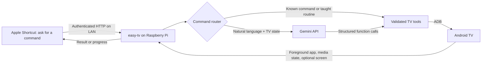

# easy-tv

Turn an always-on Raspberry Pi into a configurable Android TV controller. Speak a request through one Apple Shortcut, let Gemini interpret it using the TV's observed state, and execute bounded ADB actions. Short commands such as “PlayStation” work without an AI request.

**Status: early release, extracted from a working home prototype.** The portable package has automated tests; it has not been deployed back onto the original system. See [tested support and limitations](docs/COMPATIBILITY.md) before installing.



The core API is independent of the voice assistant. Apple Shortcuts is the first documented client; Android and Echo integrations are future work. Siri starts the named shortcut and then asks for your request. This does not replace Siri's system-wide command interpretation.

## What it does

- Switch inputs with device aliases, launch apps, control navigation, volume, sleep and media playback.
- Interpret compound requests using Gemini function calling, inspect state, perform actions and check results.
- Search regional availability across configured Netflix, base Prime Video, Hotstar and Apple TV adapters; prefer included offers, then optionally open Stremio.
- Teach a routine using physical remote presses, save it under a name, and replay with screen checkpoints.
- Report `status`, cancel background jobs and provide honest feedback when playback cannot be verified.

The prototype confirmed switching to PlayStation, playing **Silo** through Apple TV after profile selection, and playing **Dune (2021)** through Netflix. App launch alone is never presented as verified title playback.

## Quick start on a new Pi

Requires Python 3.11+, ADB, network debugging on the TV, and a Gemini API key for flexible requests. Use a trusted LAN. This project does not install software on your TV.

```sh
# In this repository checkout; creates its own virtual environment.
sh scripts/install-pi.sh
# Use the path printed by the installer, or add its bin directory to PATH.
~/.local/share/easy-tv/venv/bin/easy-tv init \
  --tv tv.local:5555 \
  --listen 0.0.0.0 \
  --allow-cidr YOUR_LAN_CIDR
~/.local/share/easy-tv/venv/bin/easy-tv configure-gemini
~/.local/share/easy-tv/venv/bin/easy-tv connect
# Approve this Pi's ADB authorization prompt on the television.
~/.local/share/easy-tv/venv/bin/easy-tv serve
```

Replace `tv.local:5555` and `YOUR_LAN_CIDR` with your own TV address and home network, such as `192.0.2.0/24` (documentation example only). For a first local test, omit `--listen` and `--allow-cidr`; the bridge defaults to loopback access only.

In a second terminal:

```sh
easy-tv send inputs
easy-tv send PlayStation
easy-tv send 'Find Silo, the 2023 series, and play it'
easy-tv send status
easy-tv send cancel
```

[Set up the one iPhone Shortcut](docs/APPLE_SHORTCUTS.md), then optionally [install the Linux service](docs/INSTALLATION.md). No Mac is needed for manually creating the iPhone Shortcut. A Mac is needed only to sign the included generated template.

## Configuration

Settings and runtime data live in `~/.config/easy-tv/`, separate from source and installations. Choose a different directory with `EASY_TV_HOME` or `easy-tv --home /path/to/config …`. The API uses **port 8767** by default. Installing the package does not connect to the TV or start a service.

The default `xiaomi-android9` profile reproduces the tested Xiaomi input IDs, FLauncher home positioning and app packages. TV address and secrets have no shipped defaults. The region defaults to `IN`, provider order to Netflix → Prime Video → Hotstar → Apple TV, and optional fallback to Stremio. Gemini defaults to the prototype's `gemini-3.5-flash-lite`; model availability depends on your account and may change.

Use `init --profile generic-androidtv` for another device, then configure its input IDs and launcher. Profiles are starting points, not hardware autodetection. [Full configuration reference](docs/CONFIGURATION.md).

## Development

```sh
python3 -m venv .venv
.venv/bin/python -m pip install -e . build
.venv/bin/python -m unittest discover -s tests -v
.venv/bin/python -m build
# For shareable release artifacts after staging intended files in Git:
.venv/bin/python tools/build_release.py
```

Tests mock ADB, model responses and catalogue HTTP responses. API tests bind only an ephemeral loopback port. They do not operate a TV or contact Gemini. [Contributing](CONTRIBUTING.md).

## Boundaries

Different firmware, DRM, profiles, subscriptions and app versions affect automation. Availability data does not prove your account entitlement. Public catalogue HTML can change; this adapter fails rather than inventing links. Stremio depends on your own legitimate add-ons and may need manual stream/episode selection. No add-ons, accounts, subscriptions or streams are bundled.

The API uses bearer authentication and a client-network allowlist. Plain HTTP is intended for a trusted LAN; use a correctly configured TLS reverse proxy or private VPN for other access. Do not forward its port to the internet. Gemini receives your request, TV state and any requested screen inspection. [Security and data handling](SECURITY.md).

Implementation references: [Android ADB](https://developer.android.com/tools/adb), [Gemini function calling](https://ai.google.dev/gemini-api/docs/function-calling), [Apple Shortcuts HTTP requests](https://support.apple.com/guide/shortcuts/request-your-first-api-apd58d46713f/ios). easy-tv is an independent project, unaffiliated with those vendors.

MIT licensed. No credentials, personal network details, learned routines, recordings or account data are included.
